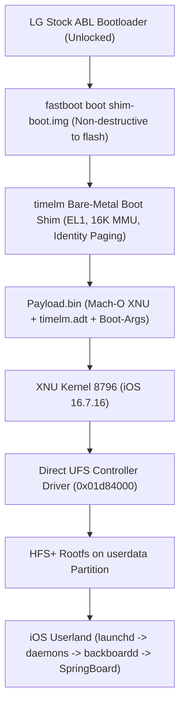

# ios-timelm

**Apple's iOS 16 running on the LG V60 ThinQ 5G (Qualcomm SM8250 / Snapdragon 865).**

This project ports Apple's open-source XNU kernel (`xnu-8796`, iOS 16 era) to the **LG V60 ThinQ 5G** (`timelm`, Qualcomm SM8250). On top of the XNU kernel runs the **unmodified iOS 16.7.16 (20H392) userland of the iPhone X (`iPhone10,3` / `D22AP`)**: `launchd`, system daemons, `backboardd`, `SpringBoard` and stock applications.

Based on reference work from [`ios-sweet`](https://github.com/dipa-studio/ios-sweet.git) (SM7150) and hardware reverse-engineering data from our SM8250 Linux mainline tree (`sm8250-mainline`).

> [!WARNING]
> Experimental bring-up for operating system research. The root filesystem installs into the `userdata` partition as HFS+ and will erase existing Android user data. Keep backups of your device partitions (`boot`, `dtbo`, `vbmeta`, `modemst1`, `modemst2`, `fsg`, `fsc`, `persist`).

---

## Hardware Specifications & Mainline Porting Data

| Subsystem | LG V60 ThinQ 5G (`timelm`) | Implementation / Mapping |
| :--- | :--- | :--- |
| **SoC** | Qualcomm Snapdragon 865 (SM8250) | Kryo 585 (ARMv8.2-A + Crypto, 16K granule) |
| **CPU Cores** | 4× Cortex-A55 (1.80 GHz) + 3× Cortex-A77 (2.42 GHz) + 1× Cortex-A77 Prime (2.84 GHz) | Homogeneous SMP via PSCI `CPU_ON`, 8 cores |
| **Interrupts** | ARM GICv3 (`0x17a00000`, GICR `0x17a60000`, 8 PEs) | Group 1 Non-Secure IRQs, Virtual Timer PPI 19 (`0x13`) |
| **Timer** | ARM Arch Generic Timer (`19.2 MHz`) | `CNTFRQ` = 19200000 Hz, VTIMER INTID = 19 |
| **RAM** | 8 GiB LPDDR5 | Low bank `0x80000000`, contiguous `0xc0000000`-`0x17fffffff`, High DDR `0x100000000` |
| **Display** | P-OLED 1080×2460 @ 60Hz (DSC Command Mode) | Continuous splash ABL framebuffer at `0x9c000000` (stride 4320). Presented to iOS as iPhone X (1125×2436 @ 3x) |
| **Storage** | UFS 3.0 (`ufshc@1d84000`, size `0x3000`) | Custom kernel UFS direct host driver; HFS+ root volume on `userdata` |
| **Touch** | Synaptics / LG `sw42902` on I²C (`touchscreen@28`, IRQ 39) | I²C GENI controller, HID digitizer event service |
| **Keys** | PM8150 / PM8150B SPMI PON | Power, Volume Up, Volume Down HID consumer keys |
| **Identity** | iPhone X (`iPhone10,3` / `D22AP`) | Tall-screen gesture UI, home-button-less navigation |

---

## Boot Architecture



The boot shim is packaged as a standard Android `boot.img` v2 and booted temporarily via `fastboot boot shim/out/shim-boot.img`. Nothing is written to the device's boot partitions.

---

## Directory Structure

```text
~/xnu/
├── ios-sweet/          # Upstream reference project (Qualcomm SM7150)
└── ios-timelm/         # LG V60 ThinQ 5G (Qualcomm SM8250) Port
    ├── .github/        # GitHub Actions CI build workflows (xnu.yml)
    ├── dtb/            # Stock & mainline timelm DTB for boot image wrapping
    ├── shim/           # Bare-metal AArch64 bootloader shim (C + asm)
    │   ├── build.sh    # Builds shim and packages shim-boot.img
    │   ├── console.c/h # 1080x2460 framebuffer text console at 0x9c000000
    │   ├── loader.c    # Loads XNU Mach-O + ADT + boot-args
    │   ├── mmu.c/h     # 16K granule EL1 stage-1 MMU
    │   └── ufs.c/h     # UFS 3.0 controller probe and read driver
    ├── tools/          # Build tools and host utilities
    │   ├── mkadt.py    # Generates timelm Apple Device Tree (.adt)
    │   ├── mkpayload.py# Merges Mach-O + ADT + cmdline into payload.bin
    │   ├── mkiosroot.sh# Prepares HFS+ root filesystem from IPSW
    │   └── timelm-root-tweaks.py
    └── xnu/            # XNU patch series for Qualcomm SM8250
        └── patches/    # 0001-0081 patch series adapted for timelm
```

---

## How to Build & Boot

### 1. Build the Boot Shim
```sh
cd ~/xnu/ios-timelm/shim
./build.sh
# Produces: out/Image and out/shim-boot.img
```

### 2. Generate Apple Device Tree (ADT)
```sh
cd ~/xnu/ios-timelm
python3 tools/mkadt.py shim/out/timelm.adt --highmem
```

### 3. Build Kernel Payload
Once `kernel.development.timelm` is built via GitHub Actions CI:
```sh
python3 tools/mkpayload.py xnu/out/kernel.development.timelm shim/out/timelm.adt shim/out/payload.bin \
    --cmdline 'debug=0xc serial=3 cpus=8 keepsyms=1 -enable_kprintf_spam -noprogress rd=ufsroot0 unentitled_ios_sim_launch=1 ignition_level=1 wdt_test=no_user_checkin ufsrw=1 rootrw=1 launchd_unsecure_cache=1 wdt=-1 sweetfb_noconsole=1 sweetfb_hz=30'

# Repack boot image with payload
shim/build.sh shim/out/payload.bin
```

### 4. Boot Device
```sh
adb reboot bootloader
fastboot boot shim/out/shim-boot.img
```
